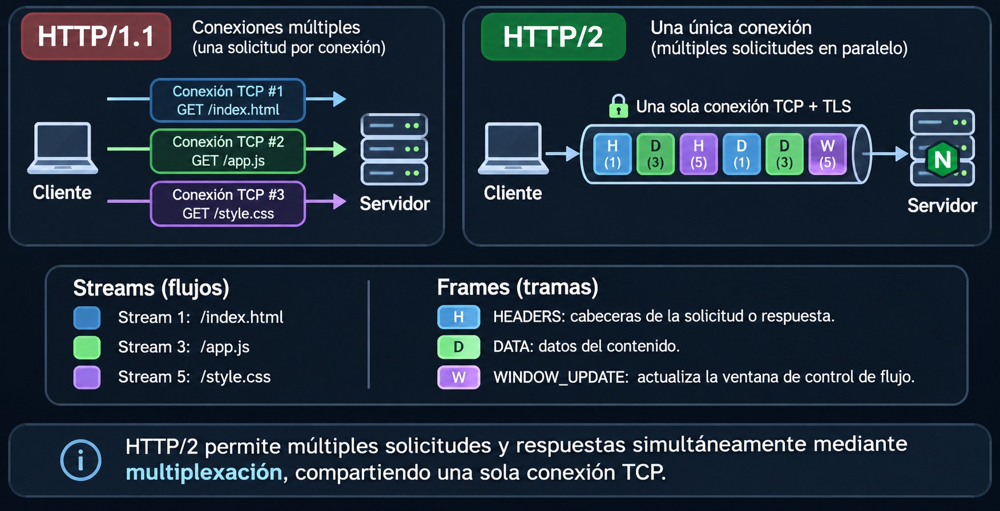

# NGINX2ROOT — análisis y laboratorio de seguridad

## Introducción

El 18 de noviembre de 2026 se divulgaron públicamente cinco vulnerabilidades de seguridad que afectan a NGINX, identificadas conjuntamente bajo el nombre **NGINX2ROOT**.

Estas vulnerabilidades fueron descubiertas por el equipo de investigación de seguridad de **Xint** y están relacionadas con errores en la administración de memoria durante el procesamiento de diferentes protocolos y servicios implementados por NGINX.

Las vulnerabilidades se identifican como:

- **CVE-2026-123007:** procesamiento y control de flujo de HTTP/2.
- **CVE-2026-123633:** procesamiento de HTTP/2 en configuraciones de proxy inverso.
- **CVE-2026-123634:** resolución dinámica de nombres DNS.
- **CVE-2026-121810:** procesamiento de HTTP/3 en configuraciones de proxy inverso.
- **CVE-2026-113425:** procesamiento de la autenticación en el proxy de correo.

En determinadas condiciones, estas vulnerabilidades pueden permitir que un atacante no autenticado consiga ejecutar código con los privilegios del proceso trabajador de NGINX.

En este laboratorio vamos a centrarnos principalmente en la vulnerabilidad **CVE-2026-123007**, que afecta al mecanismo de control de flujo del protocolo HTTP/2 y está presente desde la versión 1.9.5 de NGINX, publicada en 2015.

### Herramientas y referencias del laboratorio

Para desarrollar nuestras experiencias utilizaremos como punto de partida el trabajo realizado por los investigadores del equipo **Censys ARC (Adversary Research and Countermeasures)**.

Este equipo desarrolló y publicó un conjunto de herramientas, pruebas de concepto y capturas de tráfico obtenidas mediante experimentación en entornos aislados.

Su trabajo permite estudiar el comportamiento de las vulnerabilidades, comparar versiones afectadas y corregidas, y analizar las evidencias obtenidas durante las pruebas.

El objetivo de nuestro laboratorio será comprender el funcionamiento de la vulnerabilidad, reproducir experimentalmente el comportamiento del servidor y analizar sus implicaciones desde la perspectiva de la seguridad y la administración de sistemas GNU/Linux.

**Investigación original de Xint:**

https://nginx2root.com/

**Artículo técnico de Censys:**

[nginx2root: A simple test for the HTTP/2 flaw and three use-after-free reproductions](https://censys.com/blog/nginx2root-simple-test/)

**Repositorio desarrollado por Censys Research:**

https://github.com/Censys-Research/nginx2root

### Consideraciones éticas y de seguridad

Este laboratorio tiene una finalidad exclusivamente educativa y de investigación en seguridad informática. Las técnicas y herramientas utilizadas deben aplicarse únicamente sobre sistemas propios o sobre infraestructuras para las cuales se disponga de autorización expresa.

El hacking ético implica comprender el funcionamiento de las vulnerabilidades, reproducirlas en condiciones controladas y utilizar el conocimiento adquirido para mejorar la seguridad de los sistemas informáticos.

Antes de realizar cualquier experiencia de este tipo, es importante considerar las siguientes recomendaciones:

- **Utilizar entornos virtualizados y aislados:** realizar las pruebas dentro de máquinas virtuales o contenedores, evitando comprometer el sistema operativo principal y otros equipos de la red.
- **Controlar la exposición del laboratorio:** evitar publicar servicios vulnerables en Internet y restringir las comunicaciones de red a las estrictamente necesarias para la experimentación.
- **Utilizar herramientas de fuentes confiables:** priorizar pruebas de concepto y exploits publicados por investigadores reconocidos, equipos de seguridad y proyectos con antecedentes verificables.
- **Revisar el código antes de ejecutarlo:** incluso cuando una herramienta provenga de una fuente reconocida, es fundamental comprender qué operaciones realiza, qué recursos utiliza y qué comunicaciones establece.
- **Utilizar asistentes de inteligencia artificial como apoyo:** herramientas como ChatGPT o Claude pueden ayudarnos a analizar código, identificar comportamientos sospechosos y comprender el funcionamiento de un exploit. Sin embargo, sus resultados no sustituyen la revisión técnica ni garantizan que el código sea seguro.
- **Evitar el uso de información sensible:** no utilizar credenciales reales, claves privadas, datos personales ni configuraciones pertenecientes a entornos de producción.
- **Preparar mecanismos de recuperación:** utilizar snapshots de máquinas virtuales y entornos descartables que permitan recuperar el estado inicial del laboratorio.
- **Aplicar el principio de privilegios mínimos:** evitar ejecutar herramientas con permisos administrativos cuando no sea estrictamente necesario.

Debemos tener presente que las herramientas utilizadas para investigar vulnerabilidades también pueden representar un riesgo para quien las ejecuta. Un exploit descargado de Internet podría contener código malicioso dirigido contra el propio investigador.

El objetivo no es solamente comprender cómo se explota una vulnerabilidad, sino también desarrollar una metodología de experimentación responsable, segura y reproducible.

## Análisis técnico de la vulnerabilidad CVE-2026-123007

### El protocolo HTTP/2

HTTP/2 es una versión del protocolo HTTP que permite transmitir múltiples solicitudes y respuestas simultáneamente sobre una misma conexión TCP. Su objetivo es mejorar la eficiencia de las comunicaciones entre clientes y servidores web.

Podemos observar la versión del protocolo utilizada durante una comunicación HTTP mediante la herramienta `curl`.

Para realizar una solicitud utilizando HTTP/1.1:

```bash
curl -vs --http1.1 https://www.google.com/ -o /dev/null
```

Fragmento representativo de la salida:

```text
* ALPN: server accepted http/1.1
> GET / HTTP/1.1
> Host: www.google.com
> Accept: */*
< HTTP/1.1 200 OK
```

Ahora realizamos una solicitud utilizando HTTP/2:

```bash
curl -vs --http2 https://www.google.com/ -o /dev/null
```

Fragmento representativo de la salida:

```text
* ALPN: server accepted h2
* using HTTP/2
> GET / HTTP/2
> Host: www.google.com
> Accept: */*
< HTTP/2 200
```

Los parámetros utilizados en ambos comandos son:

- `-v`: activa el modo verbose, mostrando información detallada sobre la conexión, la negociación del protocolo y las cabeceras HTTP.
- `-s`: activa el modo silencioso, evitando mostrar el indicador de progreso de la transferencia.
- `--http1.1`: fuerza la utilización de HTTP/1.1.
- `--http2`: solicita la utilización de HTTP/2.
- `-o /dev/null`: descarta el cuerpo de la respuesta para concentrarnos únicamente en la información de la comunicación.

En ambas salidas podemos observar la utilización de ALPN (Application-Layer Protocol Negotiation), una extensión de TLS que permite negociar el protocolo de aplicación durante el establecimiento de una conexión cifrada.

El identificador `h2` corresponde a HTTP/2, mientras que `http/1.1` identifica a HTTP/1.1.

Aunque `curl` presenta las solicitudes y respuestas de ambos protocolos de manera similar, existen diferencias importantes en la forma en que se transmite la información.

A diferencia de HTTP/1.1, HTTP/2 utiliza un formato binario para organizar la información transmitida. Los mensajes HTTP se dividen en unidades denominadas frames (tramas), que contienen información de control o datos.

Dentro de una conexión HTTP/2 pueden coexistir múltiples flujos de comunicación independientes, denominados streams. Cada stream posee un identificador que permite asociar las tramas con la solicitud o respuesta correspondiente.

Este mecanismo se conoce como multiplexación y permite que diferentes solicitudes progresen simultáneamente sin necesitar una conexión TCP independiente para cada una.

Para administrar estas comunicaciones, HTTP/2 define diferentes tipos de tramas:

| Tipo de trama | Función                                                   |
| ------------- | --------------------------------------------------------- |
| DATA          | Transportar el contenido de los mensajes HTTP.            |
| HEADERS       | Transportar las cabeceras HTTP.                           |
| SETTINGS      | Configurar parámetros de la conexión.                     |
| WINDOW_UPDATE | Incrementar la cantidad de datos que pueden transmitirse. |
| RST_STREAM    | Interrumpir un stream.                                    |
| GOAWAY        | Informar el cierre de una conexión HTTP/2.                |
| PING          | Comprobar el estado de la conexión y medir su latencia.   |

El servidor debe mantener estructuras internas que representen el estado de cada conexión y de los streams asociados. La correcta administración de estas estructuras es fundamental para el funcionamiento y la seguridad del protocolo.



### El mecanismo de control de flujo en HTTP/2

El control de flujo de HTTP/2 permite regular la cantidad de datos que un extremo de la comunicación puede enviar al otro, evitando que el receptor reciba más información de la que puede procesar.

Para implementar este mecanismo, HTTP/2 utiliza un sistema de ventanas de transmisión denominado flow control window.

Cada ventana representa la cantidad de bytes de datos que el emisor está autorizado a transmitir antes de recibir una actualización del receptor.

El control de flujo funciona en dos niveles:

- **Nivel de conexión:** regula la cantidad total de datos transmitidos a través de una conexión HTTP/2.
- **Nivel de stream:** regula la cantidad de datos transmitidos dentro de cada flujo individual.

La ventana inicial predeterminada es de 65.535 bytes. A medida que se transmiten datos mediante tramas DATA, disminuye el espacio disponible en las ventanas correspondientes.

Cuando el receptor está preparado para recibir más información, puede enviar una trama WINDOW_UPDATE indicando cuánto debe incrementarse la ventana.

Este mecanismo permite administrar los recursos disponibles y evitar que un stream consuma toda la capacidad de recepción de una conexión.

El protocolo establece reglas y límites para los valores de estas ventanas. NGINX, como implementación de HTTP/2, debe validar los valores recibidos y mantener la coherencia de sus estructuras internas durante todas las operaciones de control de flujo.

Un error en la implementación de estas operaciones puede provocar que el estado interno del servidor deje de corresponderse con el estado válido de la comunicación.

### Origen y funcionamiento de la vulnerabilidad

CVE-2026-123007 es una vulnerabilidad de corrupción de memoria que se produce debido a un error en la implementación del control de flujo de HTTP/2 en NGINX. En determinadas condiciones, puede permitir que un atacante remoto ejecute código en el servidor sin necesidad de autenticarse.

NGINX mantiene variables internas que representan la cantidad de datos que pueden transmitirse dentro de una conexión HTTP/2 y sus respectivos streams.

El problema se encuentra en las operaciones aritméticas utilizadas para administrar estos valores. Cuando el resultado de una operación excede el rango que puede representar la variable utilizada, puede producirse un desbordamiento de entero (integer overflow).

Como consecuencia, NGINX puede trabajar con valores incorrectos al administrar sus estructuras internas y las regiones de memoria asociadas al procesamiento de HTTP/2.

Esto puede provocar una escritura fuera de los límites de una región de memoria reservada dinámicamente, una condición conocida como out-of-bounds write.

Para comprender este problema debemos distinguir tres conceptos:

- **Integer overflow:** desbordamiento del rango numérico que puede representar una variable.
- **Heap:** región de memoria utilizada para almacenar datos y estructuras reservadas dinámicamente durante la ejecución de un programa.
- **Out-of-bounds write:** operación de escritura que modifica memoria situada fuera de los límites de una región reservada.

La escritura fuera de los límites puede alterar información perteneciente a otras estructuras internas del proceso NGINX.

Dependiendo de las condiciones del entorno, esta corrupción puede provocar la interrupción del proceso o permitir que un atacante altere su flujo de ejecución.

### Condiciones necesarias para su explotación

Para que un servidor NGINX esté expuesto a esta vulnerabilidad debe utilizar una versión afectada y tener habilitado el procesamiento de HTTP/2. No es necesario que la aplicación web alojada en el servidor presente una vulnerabilidad propia.

La vulnerabilidad se encuentra en el código de NGINX encargado de implementar el protocolo, por lo que puede afectar tanto a servidores que entregan contenido directamente como a aquellos que funcionan como proxy inverso.

El procesamiento vulnerable puede producirse antes de que una solicitud sea entregada a la aplicación situada detrás de NGINX.

Sin embargo, debemos distinguir entre tres situaciones:

- **Exposición:** el servidor utiliza una versión afectada y tiene HTTP/2 habilitado.
- **Reproducción de la vulnerabilidad:** se consigue provocar y observar el comportamiento interno incorrecto.
- **Explotación:** se consigue aprovechar la corrupción de memoria para alterar el flujo de ejecución del proceso.

La reproducción del comportamiento vulnerable no demuestra necesariamente que sea posible ejecutar código arbitrario en todas las instalaciones afectadas.

Las características de la compilación, la arquitectura del procesador, la disposición de la memoria y los mecanismos de protección del sistema operativo pueden influir sobre la reproducibilidad de una técnica de explotación.

### Impacto y alcance de la vulnerabilidad

La explotación exitosa de CVE-2026-123007 puede permitir la ejecución remota de código con los privilegios del proceso trabajador de NGINX. Esto no implica necesariamente obtener acceso como usuario root al sistema operativo.

NGINX utiliza una arquitectura basada en un proceso maestro (master process) y uno o varios procesos trabajadores (worker processes).

El proceso maestro administra la configuración, la apertura de recursos y el ciclo de vida de los procesos trabajadores. Estos últimos son los encargados de procesar las conexiones y solicitudes de los clientes.

#### Identificación de los procesos de NGINX

Podemos observar la arquitectura de procesos de NGINX utilizando herramientas habituales de GNU/Linux, como `ps` y `pstree`. Estas herramientas nos permiten identificar el proceso maestro, los procesos trabajadores y los usuarios con los que se ejecutan.

Para listar los procesos de NGINX ejecutamos:

```bash
ps aux | grep '[n]ginx'
```

Ejemplo de salida:

```text
USER       PID %CPU %MEM    VSZ   RSS TTY  STAT START TIME COMMAND
root      1240  0.0  0.1  11240  2048 ?    Ss   14:20 0:00 nginx: master process /usr/sbin/nginx
www-data  1241  0.0  0.2  12560  4096 ?    S    14:20 0:00 nginx: worker process
www-data  1242  0.0  0.2  12560  4096 ?    S    14:20 0:00 nginx: worker process
```

Los parámetros utilizados son:

- `a`: muestra los procesos de otros usuarios asociados a terminales.
- `u`: presenta información detallada, incluyendo el usuario propietario del proceso.
- `x`: incluye los procesos que no están asociados a una terminal.
- `grep '[n]ginx'`: filtra los procesos relacionados con NGINX sin mostrar el propio proceso de búsqueda.

En la salida podemos identificar un proceso maestro ejecutado como `root` y dos procesos trabajadores ejecutados como `www-data`.

**Visualización de la jerarquía de procesos**

La herramienta `pstree` permite representar gráficamente las relaciones jerárquicas entre los procesos del sistema operativo.

```bash
pstree -p -u 1240
```

Ejemplo de salida:

```text
nginx(1240)─┬─nginx(1241,www-data)
            └─nginx(1242,www-data)
```

Los parámetros utilizados son:

- `-p`: muestra los identificadores de los procesos (PID).
- `-u`: muestra las transiciones de usuario entre procesos.
- `1240`: identificador del proceso maestro a partir del cual queremos visualizar la jerarquía.

También podemos consultar directamente los identificadores de los procesos padres utilizando `ps`:

```bash
ps -C nginx -o user,pid,ppid,args
```

Ejemplo de salida:

```text
USER       PID  PPID COMMAND
root      1240     1 nginx: master process /usr/sbin/nginx
www-data  1241  1240 nginx: worker process
www-data  1242  1240 nginx: worker process
```

La columna `PPID` (Parent Process ID) permite identificar el proceso padre de cada proceso. En este ejemplo, ambos procesos trabajadores fueron creados por el proceso maestro, cuyo PID es 1240.

Esta separación de privilegios es especialmente importante para comprender el alcance de la vulnerabilidad estudiada. Si un atacante consigue ejecutar código dentro de un proceso trabajador, inicialmente dispondrá de los privilegios de ese proceso y no de los correspondientes al proceso maestro.

Habitualmente, el proceso maestro se ejecuta con privilegios administrativos, mientras que los procesos trabajadores utilizan una cuenta de servicio con privilegios reducidos, como nginx o www-data.

Si un atacante consigue comprometer uno de estos procesos trabajadores, el alcance inicial del ataque estará determinado por sus permisos.

Entre las posibles consecuencias se encuentran:

- Ejecución de comandos del sistema operativo.
- Lectura de archivos accesibles para el usuario de servicio.
- Modificación de archivos sobre los que el proceso tenga permisos de escritura.
- Acceso a información procesada por el servidor.
- Comunicación con otros servicios internos.
- Interrupción del funcionamiento de NGINX.

Los investigadores originales de NGINX2ROOT demostraron que esta vulnerabilidad podía combinarse con una vulnerabilidad adicional del kernel de Linux para obtener privilegios administrativos.

Es importante distinguir ambos mecanismos: CVE-2026-123007 proporciona la posibilidad de ejecución remota de código, mientras que la obtención de privilegios de root requiere condiciones o vulnerabilidades adicionales.

### Versiones afectadas y corregidas

CVE-2026-123007 afecta a NGINX desde la versión 1.9.5, publicada en 2015, hasta las versiones inmediatamente anteriores a las actualizaciones de seguridad del 18 de noviembre de 2026.

| Rama de NGINX | Primera versión corregida |
| ------------- | ------------------------- |
| Stable        | 1.30.7                    |
| Mainline      | 1.31.9                    |

La vulnerabilidad permaneció presente en el código de NGINX durante aproximadamente once años.

En distribuciones GNU/Linux debemos considerar que los mantenedores pueden incorporar correcciones de seguridad mediante backports, sin actualizar necesariamente el número principal de versión del software.

Por lo tanto, identificar la versión anunciada por un servidor constituye un primer indicador de exposición, pero no permite determinar de manera concluyente si la instalación incorpora las correcciones correspondientes.

### Referencias técnicas

- Especificación del protocolo HTTP/2 (RFC 9113): https://www.rfc-editor.org/rfc/rfc9113.html
- Avisos oficiales de seguridad de NGINX: https://nginx.org/en/security_advisories.html
- Investigación original: https://nginx2root.com/
- Análisis de seguridad de Censys: https://censys.com/advisory/nginx2root/

## Herramientas y entorno de experimentación

Para realizar las experiencias utilizaremos las herramientas publicadas por Censys Research, que permiten estudiar el comportamiento de las vulnerabilidades NGINX2ROOT en entornos controlados y comparar versiones vulnerables y corregidas de NGINX.

### Herramientas disponibles

El repositorio de Censys Research incluye los siguientes recursos:

- Pruebas de concepto para reproducir el comportamiento de las vulnerabilidades.
- Herramientas desarrolladas en Python.
- Capturas de tráfico para analizar las comunicaciones HTTP/2.
- Evidencias experimentales obtenidas por los investigadores.
- Herramientas para comprobar la compatibilidad de los entornos.

Nos concentraremos inicialmente en los recursos relacionados con CVE-2026-123007.

**Script de pruebas**

El script `h2c_flow_control_test.py` admite los siguientes argumentos:

| Argumento                 | Valor por defecto | Función                                                      |
| ------------------------- | ----------------- | ------------------------------------------------------------ |
| `--host`                  | `127.0.0.1`       | Dirección IP del servidor. Solo admite loopback.             |
| `--port`                  | `80`              | Puerto del servidor.                                         |
| `--tls`                   | Desactivado       | Utiliza HTTP/2 sobre TLS.                                    |
| `--docker`                | Desactivado       | Ejecuta las pruebas en contenedores Docker aislados.         |
| `--platform`              | `native`          | Arquitectura Docker: `native`, `linux/amd64` o `linux/arm64`. |
| `--output`                | Ninguno           | Guarda los resultados en un archivo JSON en modo Docker.     |
| `--versions`              | `1.31.8,1.31.9`   | Versiones de NGINX que se quieren evaluar.                   |
| `--command-timeout`       | `45`              | Tiempo máximo por operación Docker, entre 1 y 120 segundos.  |
| `--client-timeout`        | `45`              | Tiempo máximo por prueba, entre 1 y 120 segundos.            |
| `--acknowledge-local-lab` | Obligatorio       | Requiere el valor `I-AUTHORIZE-LOCAL-LAB`.                   |
| `--help`                  | —                 | Muestra la ayuda del script.                                 |

**Restricciones y particularidades:**

- `--docker` y `--tls` son mutuamente excluyentes.
- Las versiones admitidas son desde `1.30.0` hasta `1.30.6` y desde `1.31.0` hasta `1.31.9`.
- El soporte TLS no está validado.
- Aunque `--platform` permite seleccionar ARM64, el contenedor cliente tiene AMD64 fijado explícitamente en el código.
- La prueba comprueba un error de contabilización del control de flujo HTTP/2, no la ejecución remota de código (RCE).

### Prueba de concepto

Una prueba de concepto (Proof of Concept o PoC) es una implementación experimental cuyo objetivo es demostrar que una hipótesis técnica puede reproducirse en condiciones determinadas.

En el ámbito de la seguridad informática, una PoC permite demostrar la existencia de una vulnerabilidad, reproducir un comportamiento anómalo o comprobar que una determinada técnica de explotación es viable.

Una prueba de concepto no necesariamente constituye un exploit completo. Podemos distinguir entre:

- **PoC de vulnerabilidad:** demuestra que existe un comportamiento incorrecto en el software.
- **PoC de explotación:** demuestra que ese comportamiento puede aprovecharse para realizar una operación no prevista por el desarrollador.
- **Exploit:** código o procedimiento diseñado para aprovechar una vulnerabilidad y conseguir un resultado determinado, como la ejecución remota de código o la elevación de privilegios.

Estas categorías no son excluyentes. Una prueba de concepto también puede implementar un exploit funcional.

En nuestro laboratorio, la prueba de concepto desarrollada por Censys permite demostrar el funcionamiento incorrecto del control de flujo de HTTP/2 y comparar el comportamiento de una versión vulnerable de NGINX con una versión corregida, sin necesidad de ejecutar código arbitrario en el servidor.

Esta distinción es importante porque demostrar la existencia de una vulnerabilidad no equivale necesariamente a demostrar todas sus posibilidades de explotación.

### Entorno de laboratorio

Las experiencias se realizarán sobre un sistema GNU/Linux virtualizado, utilizando Docker para desplegar instancias independientes de NGINX.

Esto nos permitirá trabajar con diferentes versiones y configuraciones del servidor, comparar su comportamiento y reproducir las pruebas sin modificar el sistema operativo principal.

### Obtención y revisión del código fuente

Obtenemos una copia local del repositorio de Censys Research:

```bash
git clone https://github.com/Censys-Research/nginx2root.git
cd nginx2root
```

Antes de ejecutar cualquiera de las herramientas, revisaremos el contenido del repositorio, sus dependencias y las operaciones que realiza cada programa.


Genera los contendores con las imágenes `nginx:1.31.8` y `nginx:1.31.9`, y Python 3.10 o superior.

```
python3 -I h2c_flow_control_test.py \
  --docker \
  --output /tmp/nginx2root-compact-evidence.json \
  --command-timeout 45 \
  --client-timeout 45 \
  --acknowledge-local-lab I-AUTHORIZE-LOCAL-LAB
```

**Resultado esperado:**

Prueba superada: la versión vulnerable de h2c aceptó el exceso de crédito, mientras que la versión parcheada lo rechazó.

El script crea una red interna de Docker, ejecuta las instancias vulnerable y parcheada, y elimina los recursos al finalizar. No utiliza puertos publicados ni la red del host.

El archivo JSON de evidencias registra el hash del script, los resultados de cada instancia y el estado de la limpieza de recursos.

Los tiempos de espera están limitados a un máximo de 120 segundos.

Salida:

```
PASS: vulnerable h2c accepted over-credit; patched control rejected it
Wrote evidence: /tmp/nginx2root-compact-evidence.json
```

Evidencia:

```
{
  "schema_version": 1,
  "cve": "CVE-2026-123007",
  "test": "compact-h2c-accounting-differential",
  "scope": "accounting_only_not_rce",
  "tls_validated": false,
  "network": "internal_docker_no_published_ports",
  "timeout_seconds": 45,
  "target_images": [
    "nginx:1.31.8",
    "nginx:1.31.9"
  ],
  "script_sha256": "6e6f7726ac8f6bddd711af703d2f180cefe1f0f0c4b27860eb7f96d06c6ffa01",
  "started_at": "2026-11-24T20:10:25.615198+00:00",
  "targets": [
    {
      "image": "nginx:1.31.8",
      "version": "1.31.8",
      "expected_exit": 0,
      "actual_exit": 0,
      "result": "passed",
      "detail": "ream=157 flags=0 len=8192\n      <- DATA stream=157 flags=0 len=8191\n      <- DATA stream=157 flags=0 len=8192\n      <- DATA stream=157 flags=0 len=8192\n      <- DATA stream=157 flags=0 len=8192\n      <- DATA stream=157 flags=0 len=8192\n      <- DATA stream=157 flags=0 len=8192\n      <- DATA stream=157 flags=0 len=8192\n      <- DATA stream=157 flags=0 len=8192\n      <- DATA stream=157 flags=0 len=8191\n      <- DATA stream=157 flags=0 len=8192\n      <- DATA stream=157 flags=0 len=8192\n      <- DATA stream=157 flags=0 len=8192\n      <- DATA stream=157 flags=0 len=8192\n      <- DATA stream=157 flags=0 len=8192\n      <- DATA stream=157 flags=0 len=8192\n      <- DATA stream=157 flags=0 len=8192\n      <- DATA stream=157 flags=0 len=8191\n      <- DATA stream=157 flags=0 len=8192\n      <- DATA stream=157 flags=0 len=8192\n      <- DATA stream=157 flags=0 len=8192\n      <- DATA stream=157 flags=0 len=8192\n      <- DATA stream=157 flags=0 len=8192\n      <- DATA stream=157 flags=0 len=8192\n      <- DATA stream=157 flags=0 len=8192\n      <- DATA stream=157 flags=0 len=8191\n      <- DATA stream=157 flags=0 len=8192\n      <- DATA stream=157 flags=0 len=8192\n      <- DATA stream=157 flags=0 len=8192\n      <- DATA stream=157 flags=0 len=8192\n      <- DATA stream=157 flags=0 len=8192\n      <- DATA stream=157 flags=0 len=8192\n      <- DATA stream=157 flags=0 len=8192\n      <- DATA stream=157 flags=0 len=8191\n      <- DATA stream=157 flags=0 len=8192\n      <- DATA stream=157 flags=0 len=8192\n      <- DATA stream=157 flags=0 len=8192\n      <- DATA stream=157 flags=0 len=8192\n      <- DATA stream=157 flags=0 len=8192\n      <- DATA stream=157 flags=0 len=8192\n      <- DATA stream=157 flags=0 len=8192\n      <- DATA stream=157 flags=0 len=8191\n      <- DATA stream=157 flags=0 len=8192\n      <- DATA stream=157 flags=0 len=8192\n      <- DATA stream=157 flags=0 len=8192\n      <- DATA stream=157 flags=0 len=8192\n      <- DATA stream=157 flags=0 len=8192\n      <- DATA stream=157 flags=0 len=8192\n      <- DATA stream=157 flags=0 len=8192\n      <- DATA stream=157 flags=0 len=8191\n      <- DATA stream=157 flags=0 len=8192\n      <- DATA stream=157 flags=0 len=8192\n      <- DATA stream=157 flags=0 len=8192\n      <- DATA stream=157 flags=0 len=8192\n      <- DATA stream=157 flags=0 len=8192\n      <- DATA stream=157 flags=0 len=8192\n      <- DATA stream=157 flags=0 len=8192\n      <- DATA stream=157 flags=0 len=8191\n      <- DATA stream=157 flags=0 len=8192\n      <- DATA stream=157 flags=0 len=8192\n      <- DATA stream=157 flags=0 len=8192\n      <- DATA stream=157 flags=0 len=8192\n      <- DATA stream=157 flags=0 len=8192\n      <- DATA stream=157 flags=0 len=8192\n      <- DATA stream=157 flags=0 len=8192\n      <- DATA stream=157 flags=0 len=8191\n      <- DATA stream=157 flags=0 len=8192\n      <- DATA stream=157 flags=0 len=8192\n      <- DATA stream=157 flags=0 len=8192\n      <- DATA stream=157 flags=0 len=8192\n      <- DATA stream=157 flags=0 len=8192\n      <- DATA stream=157 flags=0 len=8192\n      <- DATA stream=157 flags=0 len=8192\n      <- DATA stream=157 flags=0 len=8191\n      <- DATA stream=157 flags=0 len=8192\n      <- DATA stream=157 flags=0 len=8192\n      <- DATA stream=157 flags=0 len=8192\n      <- DATA stream=157 flags=0 len=8192\n      <- DATA stream=157 flags=0 len=8192\n      <- DATA stream=157 flags=0 len=8192\n      <- DATA stream=157 flags=0 len=8192\n      <- DATA stream=157 flags=0 len=8191\n      <- DATA stream=157 flags=0 len=8192\n      <- DATA stream=157 flags=0 len=8192\n      <- DATA stream=157 flags=0 len=8192\n      <- DATA stream=157 flags=0 len=8192\n      <- DATA stream=157 flags=0 len=8192\n      <- DATA stream=157 flags=0 len=8192\n      <- DATA stream=157 flags=0 len=8192\n      <- DATA stream=157 flags=0 len=8191\n== stage 5: probe WINDOW_UPDATE(0, 1): accepted => over-credit\n== stage 6: sync PING\n      <- PING stream=0 flags=1\n>>> OVER-CREDIT: one-byte update accepted, no GOAWAY or TCP close, and post-probe PING acknowledged; CVE-2026-123007 accounting error observed\nThis is an accounting test only; it does not demonstrate code execution.\n"
    },
    {
      "image": "nginx:1.31.9",
      "version": "1.31.9",
      "expected_exit": 1,
      "actual_exit": 1,
      "result": "passed",
      "detail": "<- DATA stream=157 flags=0 len=8192\n      <- DATA stream=157 flags=0 len=8192\n      <- DATA stream=157 flags=0 len=8192\n      <- DATA stream=157 flags=0 len=8192\n      <- DATA stream=157 flags=0 len=8192\n      <- DATA stream=157 flags=0 len=8192\n      <- DATA stream=157 flags=0 len=8191\n      <- DATA stream=157 flags=0 len=8192\n      <- DATA stream=157 flags=0 len=8192\n      <- DATA stream=157 flags=0 len=8192\n      <- DATA stream=157 flags=0 len=8192\n      <- DATA stream=157 flags=0 len=8192\n      <- DATA stream=157 flags=0 len=8192\n      <- DATA stream=157 flags=0 len=8192\n      <- DATA stream=157 flags=0 len=8191\n      <- DATA stream=157 flags=0 len=8192\n      <- DATA stream=157 flags=0 len=8192\n      <- DATA stream=157 flags=0 len=8192\n      <- DATA stream=157 flags=0 len=8192\n      <- DATA stream=157 flags=0 len=8192\n      <- DATA stream=157 flags=0 len=8192\n      <- DATA stream=157 flags=0 len=8192\n      <- DATA stream=157 flags=0 len=8191\n      <- DATA stream=157 flags=0 len=8192\n      <- DATA stream=157 flags=0 len=8192\n      <- DATA stream=157 flags=0 len=8192\n      <- DATA stream=157 flags=0 len=8192\n      <- DATA stream=157 flags=0 len=8192\n      <- DATA stream=157 flags=0 len=8192\n      <- DATA stream=157 flags=0 len=8192\n      <- DATA stream=157 flags=0 len=8191\n      <- DATA stream=157 flags=0 len=8192\n      <- DATA stream=157 flags=0 len=8192\n      <- DATA stream=157 flags=0 len=8192\n      <- DATA stream=157 flags=0 len=8192\n      <- DATA stream=157 flags=0 len=8192\n      <- DATA stream=157 flags=0 len=8192\n      <- DATA stream=157 flags=0 len=8192\n      <- DATA stream=157 flags=0 len=8191\n      <- DATA stream=157 flags=0 len=8192\n      <- DATA stream=157 flags=0 len=8192\n      <- DATA stream=157 flags=0 len=8192\n      <- DATA stream=157 flags=0 len=8192\n      <- DATA stream=157 flags=0 len=8192\n      <- DATA stream=157 flags=0 len=8192\n      <- DATA stream=157 flags=0 len=8192\n      <- DATA stream=157 flags=0 len=8191\n      <- DATA stream=157 flags=0 len=8192\n      <- DATA stream=157 flags=0 len=8192\n      <- DATA stream=157 flags=0 len=8192\n      <- DATA stream=157 flags=0 len=8192\n      <- DATA stream=157 flags=0 len=8192\n      <- DATA stream=157 flags=0 len=8192\n      <- DATA stream=157 flags=0 len=8192\n      <- DATA stream=157 flags=0 len=8191\n      <- DATA stream=157 flags=0 len=8192\n      <- DATA stream=157 flags=0 len=8192\n      <- DATA stream=157 flags=0 len=8192\n      <- DATA stream=157 flags=0 len=8192\n      <- DATA stream=157 flags=0 len=8192\n      <- DATA stream=157 flags=0 len=8192\n      <- DATA stream=157 flags=0 len=8192\n      <- DATA stream=157 flags=0 len=8191\n      <- DATA stream=157 flags=0 len=8192\n      <- DATA stream=157 flags=0 len=8192\n      <- DATA stream=157 flags=0 len=8192\n      <- DATA stream=157 flags=0 len=8192\n      <- DATA stream=157 flags=0 len=8192\n      <- DATA stream=157 flags=0 len=8192\n      <- DATA stream=157 flags=0 len=8192\n      <- DATA stream=157 flags=0 len=8191\n      <- DATA stream=157 flags=0 len=8192\n      <- DATA stream=157 flags=0 len=8192\n      <- DATA stream=157 flags=0 len=8192\n      <- DATA stream=157 flags=0 len=8192\n      <- DATA stream=157 flags=0 len=8192\n      <- DATA stream=157 flags=0 len=8192\n      <- DATA stream=157 flags=0 len=8192\n      <- DATA stream=157 flags=0 len=8191\n      <- DATA stream=157 flags=0 len=8192\n      <- DATA stream=157 flags=0 len=8192\n      <- DATA stream=157 flags=0 len=8192\n      <- DATA stream=157 flags=0 len=8192\n      <- DATA stream=157 flags=0 len=8192\n      <- DATA stream=157 flags=0 len=8192\n      <- DATA stream=157 flags=0 len=8192\n      <- DATA stream=157 flags=0 len=8191\n      <- DATA stream=157 flags=0 len=8192\n      <- DATA stream=157 flags=0 len=8192\n      <- DATA stream=157 flags=0 len=8192\n    [wu4M] TCP closed\nThe 4 MiB update was rejected; the server log determines the queued-byte bound.\n== stage 5: probe WINDOW_UPDATE(0, 1): accepted => over-credit\n== stage 6: sync PING\n>>> INCONCLUSIVE: test ended before the one-byte window probe\nThis is an accounting test only; it does not demonstrate code execution.\n"
    }
  ],
  "cleanup_attempted": true,
  "passed": true
}

```


